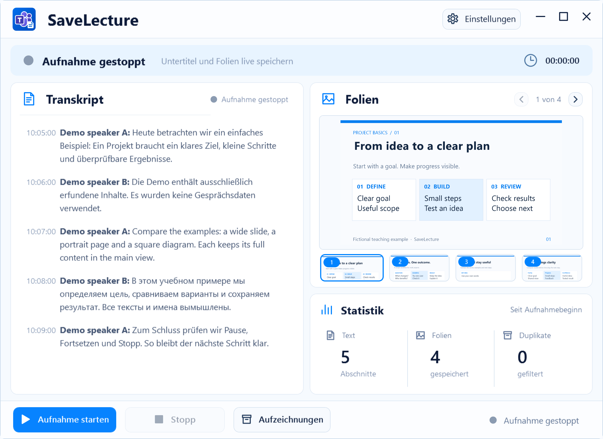

# SaveLecture

[Русский](README.ru.md) · [Deutsch](README.de.md) · [English](README.md)

Teams-Untertitel und Folien an einem Ort. SaveLecture speichert erlaubte Lernmaterialien, damit Sie sie später in Ruhe nachlesen können.

**Windows 11 · x64 · Lernprojekt · Vorabversion 0.1.0-preview.1**

[Anleitung](https://popovantondev.github.io/SaveLecture/Guide-de.html) · [Quelltext](https://github.com/popovantondev/SaveLecture) · [Fehler melden](https://github.com/popovantondev/SaveLecture/issues/new)

Echte Oberfläche. Texte, Namen und Bilder im Beispiel sind vollständig künstlich.

## Erster Start

1. Vor dem Start die Zustimmung aller Beteiligten und Erlaubnis für die Materialien einholen.
2. Das komplette Paket in einen beschreibbaren Ordner entpacken. SHA-256 des veröffentlichten Archivs prüfen. Der Release ist noch in Vorbereitung.
3. Beim ersten Start den Hinweis lesen. Ohne Bestätigung beginnt keine Erfassung. Russisch, Deutsch und Englisch stehen zur Auswahl.
4. Nach der ersten Bestätigung beginnt die Erfassung und das Hauptfenster öffnet sich. Bei späteren Starts läuft die App im Infobereich, ohne das Hauptfenster anzuzeigen. Dort lassen sich Status und Fenster öffnen. Aktivieren Sie Teams-Liveuntertitel und lassen Sie die Bildschirmfreigabe sichtbar.
5. Schließen blendet die App in den Tray aus. Pause unterbricht, Fortsetzen setzt dieselbe Vorlesung fort. Stopp beendet sie nach Bestätigung. Beenden stoppt die Erfassung ebenfalls.

## Nur mit Zustimmung aller Beteiligten

Vor dem Speichern die informierte Einwilligung aller Beteiligten und Erlaubnis für die Lernmaterialien einholen. Zweck, Datenumfang und Speicherort erklären. Bei Ablehnung oder Widerruf die Erfassung stoppen. Lernzweck und lokale Speicherung allein stellen die Rechtmäßigkeit nicht fest.

Der erste Hinweis bestätigt nur das Verständnis des Benutzers, nicht die Zustimmung anderer Personen. Ablehnung, institutionelle Vorgaben, Urheberrechte und Aufbewahrungsfristen beachten. Daten auf Anfrage nach Stopp löschen; keine Aufnahmen, Fehlerprotokolle oder Meeting-Bilder in öffentlichen Issues teilen. Archive neben der App kann gemeinsam zugänglich sein, etwa unter Public oder in synchronisierten Ordnern. Einen persönlichen Ordner mit geeigneten Zugriffsrechten wählen. Das Projekt garantiert keine Datenschutzkonformität.

## Autostart und Voraussetzungen

Unter Einstellungen „Mit Windows starten“ ein- oder ausschalten und „Fertig“ klicken. Aktiviert startet die App bei der Windows-Anmeldung im Infobereich. Nach Bestätigung des ersten Hinweises beginnt das Speichern bei jedem Start automatisch. Ein verborgenes Hauptfenster bedeutet nicht, dass die Erfassung beendet ist: Der Infobereich zeigt den Status. Pause unterbricht, Stopp beendet die Aufnahme, Beenden schließt die App. Die Hauptaufnahme benötigt Windows x64, .NET Framework 4.8, Windows PowerShell und Teams Desktop mit Untertiteln. Audio und Mikrofon werden nicht aufgenommen. SaveLecture lädt selbst keine Vorlesungen hoch; Teams-Untertitel hängen vom Microsoft-Dienst ab. InstallAutostart.ps1 und UninstallAutostart.ps1 sind eine alternative Autostarteinrichtung ohne Administrator. Manuelle Ordnerbereinigung benötigt Python 3.10+, Pillow und NumPy; die Hauptaufnahme funktioniert ohne diese.

## Ein ehrlicher Stand

Der Kandidat wird auf Speicherung und Oberfläche geprüft. Ein vollständiger Live-Test mit Teams, physische DPI-Wechsel und acht reale Betriebsstunden sind noch nicht bestätigt. Eine öffentliche Binärversion ist noch nicht veröffentlicht.

[Rechte](RIGHTS.md) · [Components](THIRD_PARTY_NOTICES.md) · [Build](docs/BUILDING.md) · [Verification](docs/VERIFICATION.md)
