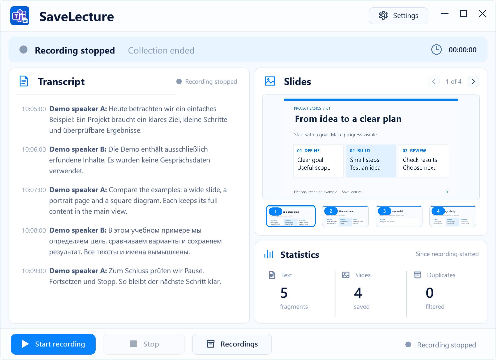

# SaveLecture

[Русский](README.ru.md) · [Deutsch](README.de.md) · [English](README.md)

Teams captions and slides, together. SaveLecture keeps permitted learning materials in one place so you can return to them later.

**Windows 11 · x64 · Educational project · preview 0.1.0-preview.1**

[Guide](https://popovantondev.github.io/SaveLecture/Guide-en.html) · [Source](https://github.com/popovantondev/SaveLecture) · [Report an issue](https://github.com/popovantondev/SaveLecture/issues/new)

Actual interface. All text, names and images in this example are artificial.

## First launch

1. Obtain permission from every participant and permission for the materials before launching.
2. Extract the whole package into a writable folder. Verify the published archive’s SHA-256. The release is still being prepared.
3. Read the first-launch notice. No collection starts before acknowledgement. Choose Russian, German or English.
4. After the first acknowledgement, collection begins and the main window opens. Later launches collect materials and show status in the system tray without opening the main window. Open it using the tray icon. Enable Teams captions and keep shared content visible.
5. Close hides the app in the tray. Pause suspends collection; Resume continues the same lecture. Stop ends it after confirmation. Exit also ends collection.

## Only with every participant’s permission

Before saving, obtain informed consent from every participant and permission for the learning materials. Explain the purpose, what is saved and where. Stop collecting if consent is refused or withdrawn. Educational purpose and local storage alone do not establish whether recording is lawful.

The first notice acknowledges the user’s understanding, not consent from other people. Respect refusal, institutional rules, copyright and retention periods. Delete data on request after stopping; never share recordings, error logs or meeting screenshots in public issues. Archive beside the app may be shared when placed in Public or a synced folder. Choose a personal folder with suitable access permissions. The project does not guarantee data-protection compliance.

## Storage and recovery

Settings → Storage lets you choose a folder after Stop.  One TXT belongs to one lecture until Stop; images are grouped by date. _service contains recovery data and indexes. After a crash the unfinished lecture ID is retained. Do not delete service files during recording. Settings and the error log live in %LOCALAPPDATA%\SaveLecture. Configure mention names in Transcription; an empty list disables notifications. Final slides are stored in Archive/date/scr. For drawings built up gradually, the gallery keeps the most complete version; superseded intermediate images move to Archive/date/Removed without deletion or overwriting name collisions. _service retains relocation links and history. Changing the storage folder does not move existing recordings.

The gallery can show an image already saved today. The app reuses the existing file instead of creating another copy. The saved count includes only new files in the current recording and starts at zero after a restart or a new recording. The duplicate count shows repeated images that were skipped. Existing files remain in the archive. “Saved” counts new files in the current recording, including intermediate frames later moved to Removed. The gallery shows final versions. “Duplicates” counts skipped repeats and each completed move of an intermediate frame to Removed once. Restarting does not recount completed moves.

## Startup and requirements

In Settings, turn “Start with Windows” on or off and click “Done”. When enabled, the app starts at Windows sign-in in the system tray. After acknowledging the first-launch notice, saving starts automatically on each launch. A hidden main window does not mean collection has stopped: the tray shows its status. Pause suspends collection, Stop ends recording, and Exit closes the app. Main recording requires Windows x64, .NET Framework 4.8, Windows PowerShell and Teams Desktop with captions enabled. Audio and microphone input are not recorded. SaveLecture itself does not upload lectures; Teams captions depend on Microsoft’s service. InstallAutostart.ps1 and UninstallAutostart.ps1 offer an alternative setup without administrator access. Manual folder cleanup requires Python 3.10+, Pillow and NumPy; main recording works without them.

## Troubleshooting

No text: check Teams captions, window visibility and app status. No images: keep sharing visible, check the delay, slides switch and folder permissions. On errors, keep _service; stop the app and back up the archive. Report the version, Windows and reproduction steps. Use only artificial examples without names, conversations, meeting links or keys. Purple waiting means no new data is currently arriving; the tray shows a rotating purple ring. When sharing is absent, the last saved slide stays visible. Captions have their own status: after 15 seconds without new lines, the app shows waiting for new captions. Yellow means Pause. “Collection enabled” means the app is ready; it does not confirm live sharing. Losing sharing does not end the recording.

## A transparent readiness status

The candidate is tested for saving and interface behavior. A full live Teams run, physical DPI changes and eight actual hours of operation have not been confirmed. No public binary release has been published yet.

[Rights](RIGHTS.md) · [Components](THIRD_PARTY_NOTICES.md) · [Build](docs/BUILDING.md) · [Verification](docs/VERIFICATION.md)
