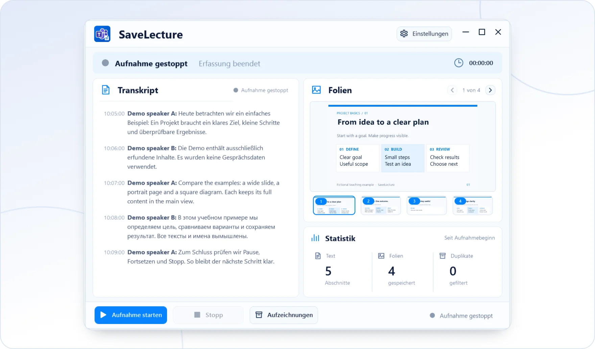

<!-- ppk-readme:head:start -->
<a href="https://popovantondev.github.io/SaveLecture/index.html"><picture><source media="(prefers-color-scheme: dark)" srcset="https://raw.githubusercontent.com/popovantondev/SaveLecture/main/docs/readme/header-de-dark.9e2f5bb7.svg"></picture></a>
<!-- ppk-readme:head:end -->

# SaveLecture

[Русский](README.ru.md) · **Deutsch** · [English](README.en.md)

<!-- ppk-readme:body:start -->

<a href="https://github.com/popovantondev/SaveLecture/releases/tag/v0.1.0-preview.4"><picture><source media="(prefers-color-scheme: dark)" srcset="https://raw.githubusercontent.com/popovantondev/SaveLecture/main/docs/readme/btn-download-de-dark.28e521cb.svg"></picture></a>
<a href="https://popovantondev.github.io/SaveLecture/index.html"><picture><source media="(prefers-color-scheme: dark)" srcset="https://raw.githubusercontent.com/popovantondev/SaveLecture/main/docs/readme/btn-website-de-dark.d617c1cf.svg"></picture></a>
<a href="https://popovantondev.github.io/SaveLecture/Guide-de.html"><picture><source media="(prefers-color-scheme: dark)" srcset="https://raw.githubusercontent.com/popovantondev/SaveLecture/main/docs/readme/btn-guide-de-dark.0ebb585d.svg"></picture></a>
<a href="https://github.com/popovantondev/SaveLecture/issues/new"><picture><source media="(prefers-color-scheme: dark)" srcset="https://raw.githubusercontent.com/popovantondev/SaveLecture/main/docs/readme/btn-bug-de-dark.4f364764.svg"></picture></a>

<a href="https://raw.githubusercontent.com/popovantondev/SaveLecture/main/website/assets/demo-de.png"><picture><source media="(prefers-color-scheme: dark)" srcset="https://raw.githubusercontent.com/popovantondev/SaveLecture/main/docs/readme/preview-de-dark.33c04494.webp"></picture></a> 
<a href="https://raw.githubusercontent.com/popovantondev/SaveLecture/main/website/assets/demo-de.png">Ganzer Screenshot</a>

<picture><source media="(prefers-color-scheme: dark)" srcset="https://raw.githubusercontent.com/popovantondev/SaveLecture/main/docs/readme/divider-dark.ac532a77.svg"></picture>
<!-- ppk-readme:body:end -->

Teams-Untertitel und Folien an einem Ort. SaveLecture speichert erlaubte Lernmaterialien, damit Sie sie später in Ruhe nachlesen können.

**Windows 11 · x64 · Lernprojekt · Vorabversion 0.1.0-preview.4**

Echte Oberfläche. Texte, Namen und Bilder im Beispiel sind vollständig künstlich.

## Erster Start

1. Vor dem Start die Zustimmung aller Beteiligten und Erlaubnis für die Materialien einholen.
2. Entpacken Sie das gesamte Release-Archiv in einen beschreibbaren Ordner. Prüfen Sie dessen veröffentlichten SHA-256-Wert.
3. Beim ersten Start den Hinweis lesen. Ohne Bestätigung beginnt keine Erfassung. Russisch, Deutsch und Englisch stehen zur Auswahl.
4. Nach der ersten Bestätigung beginnt die Erfassung und das Hauptfenster öffnet sich. Bei späteren Starts läuft die App im Infobereich, ohne das Hauptfenster anzuzeigen. Dort lassen sich Status und Fenster öffnen. Aktivieren Sie Teams-Liveuntertitel und lassen Sie die Bildschirmfreigabe sichtbar.
5. Schließen blendet die App in den Tray aus. Pause unterbricht, Fortsetzen setzt dieselbe Vorlesung fort. Stopp beendet sie nach Bestätigung. Beenden stoppt die Erfassung ebenfalls.

## Nur mit Zustimmung aller Beteiligten

Vor dem Speichern die informierte Einwilligung aller Beteiligten und Erlaubnis für die Lernmaterialien einholen. Zweck, Datenumfang und Speicherort erklären. Bei Ablehnung oder Widerruf die Erfassung stoppen. Lernzweck und lokale Speicherung allein stellen die Rechtmäßigkeit nicht fest.

Der erste Hinweis bestätigt nur das Verständnis des Benutzers, nicht die Zustimmung anderer Personen. Ablehnung, institutionelle Vorgaben, Urheberrechte und Aufbewahrungsfristen beachten. Daten auf Anfrage nach Stopp löschen; keine Aufnahmen, Fehlerprotokolle oder Meeting-Bilder in öffentlichen Issues teilen. Archive neben der App kann gemeinsam zugänglich sein, etwa unter Public oder in synchronisierten Ordnern. Einen persönlichen Ordner mit geeigneten Zugriffsrechten wählen. Meeting-Inhalte können personenbezogene Daten im Sinne der DSGVO enthalten; das heimliche Aufzeichnen des nichtöffentlich gesprochenen Wortes kann nach § 201 StGB strafbar sein. Das Projekt garantiert keine Datenschutzkonformität.

## Speicherung und Wiederherstellung

Einstellungen → Speicher erlaubt die Ordnerwahl nach Stopp.  Eine TXT gehört zu einer Vorlesung bis Stopp; Bilder werden nach Datum abgelegt. _service enthält Wiederherstellungsdaten und Indizes. Nach einem Absturz wird die unvollständige Vorlesungs-ID beibehalten. Während der Aufnahme keine Hilfsdateien löschen. Einstellungen und Fehlerprotokoll: %LOCALAPPDATA%\SaveLecture. Erwähnungsnamen unter Transkription eintragen; eine leere Liste deaktiviert Hinweise. Endgültige Folien liegen unter Archive/Datum/scr. Bei schrittweisen Ergänzungen zeigt die Galerie die vollständigste Version; ersetzte Zwischenbilder werden ohne Löschen oder Überschreiben gleichnamiger Dateien nach Archive/Datum/Removed verschoben. _service enthält die Verweise und den Verlauf. Ein Wechsel des Speicherordners verschiebt bestehende Aufnahmen nicht. Aktualisierungen derselben Äußerung werden unabhängig von Großschreibung, Satzzeichen und wechselnden Teams-Elementen zusammengeführt. Oberfläche und TXT der laufenden Vorlesung zeigen die aktuelle Fassung mit dem ersten Zeitstempel; ursprüngliche Updates bleiben zur Wiederherstellung erhalten. Frühere abgeschlossene TXT-Dateien bleiben unverändert. Bei nahezu identischen Folien mit kleinen Cursor- oder Leistenänderungen verwendet die Galerie das zuletzt gespeicherte Bild; der Vorgänger bleibt in Removed. Die TXT-Datei der laufenden Vorlesung wird sicher durch eine fertig geschriebene temporäre Kopie ersetzt. Beim Speichern kann kurz eine .tmp-Datei erscheinen; während des Betriebs nicht löschen.

Die Galerie kann ein Bild anzeigen, das heute bereits gespeichert wurde. Die App verwendet die vorhandene Datei, statt eine weitere Kopie anzulegen. „Gespeichert“ zählt nur neue Dateien der aktuellen Aufnahme und beginnt nach einem Neustart oder einer neuen Aufnahme bei null. Der Duplikatzähler zeigt übersprungene wiederholte Bilder. Vorhandene Dateien bleiben im Archiv. „Gespeichert“ zählt neue Dateien der aktuellen Aufnahme, einschließlich Zwischenbildern, die später nach Removed verschoben werden. Die Galerie zeigt endgültige Versionen. „Duplikate“ zählt übersprungene Wiederholungen und jeden durchgeführten Wechsel eines Zwischenbildes nach Removed einmal. Ein Neustart zählt abgeschlossene Verschiebungen nicht erneut. „Text“ zählt zusammengeführte Äußerungen, nicht jedes Zwischenupdate von Teams. Die Prüfung läuft im eingestellten Abstand weiter; eine unveränderte, bereits verarbeitete Folie erhöht den Zähler nicht jede Sekunde. Nach dem Schließen eines Dialogs wird das tatsächlich sichtbare Bild auf Stabilität geprüft; verdeckte Inhalte werden nicht ergänzt.

## Autostart und Voraussetzungen

Unter Einstellungen „Mit Windows starten“ ein- oder ausschalten und „Fertig“ klicken. Aktiviert startet die App bei der Windows-Anmeldung im Infobereich. Nach Bestätigung des ersten Hinweises beginnt das Speichern bei jedem Start automatisch. Ein verborgenes Hauptfenster bedeutet nicht, dass die Erfassung beendet ist: Der Infobereich zeigt den Status. Pause unterbricht, Stopp beendet die Aufnahme, Beenden schließt die App. Die Hauptaufnahme benötigt Windows x64, .NET Framework 4.8, Windows PowerShell und Teams Desktop mit Untertiteln. Audio und Mikrofon werden nicht aufgenommen. SaveLecture lädt selbst keine Vorlesungen hoch; Teams-Untertitel hängen vom Microsoft-Dienst ab. InstallAutostart.ps1 und UninstallAutostart.ps1 sind eine alternative Autostarteinrichtung ohne Administrator. Manuelle Ordnerbereinigung benötigt Python 3.10+, Pillow und NumPy; die Hauptaufnahme funktioniert ohne diese.

## Bei Problemen

Kein Text: Teams-Untertitel, Fenstersichtbarkeit und App-Status prüfen. Keine Bilder: Freigabe sichtbar halten, Wartezeit, Folien-Schalter und Schreibrechte prüfen. Bei Fehlern _service nicht löschen; App stoppen und Archiv sichern. Fehlerbericht mit Version, Windows und Schritten verfassen. Nur künstliche Beispiele ohne Namen, Nachrichten, Meeting-Links oder Schlüssel verwenden. Violettes Warten bedeutet, dass aktuell keine neuen Daten eintreffen; im Infobereich dreht sich ein violetter Ring. Ohne Bildschirmfreigabe bleibt die letzte gespeicherte Folie sichtbar. Untertitel haben einen eigenen Status: Nach 15 Sekunden ohne neue Zeilen wird auf neue Untertitel gewartet. Gelb steht für Pause. „Erfassung aktiviert“ bedeutet Bereitschaft und bestätigt keine laufende Freigabe. Fehlende Freigabe beendet die Aufnahme nicht. Version 0.1.0-preview.4 behebt die zunehmende Speicherverzögerung bei langen TXT-Dateien. Das Update stellt keine Untertitel wieder her, die Teams nicht an die App geliefert hat. Ein vollständiger Arbeitstag nach dieser Korrektur wurde noch nicht geprüft.

## Ein ehrlicher Stand

Die Lernprojekt-Vorabversion hat lokale Speicher- und Oberflächentests bestanden. Ein vollständiger Live-Teams-Test, physische DPI-Wechsel und acht reale Betriebsstunden sind noch nicht bestätigt.

## Rechte

[Rechte](RIGHTS.md) · [Komponenten](THIRD_PARTY_NOTICES.md) · [Bauanleitung](docs/BUILDING.md) · [Prüfstand](docs/VERIFICATION.md) · [Release](https://github.com/popovantondev/SaveLecture/releases/tag/v0.1.0-preview.4)
