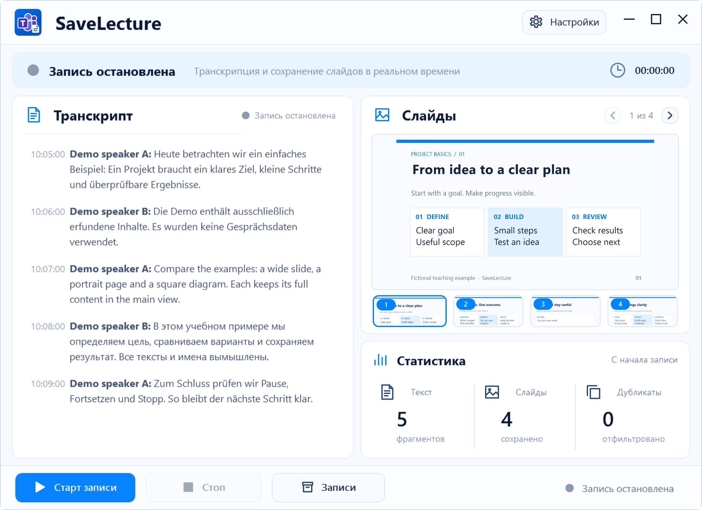

# SaveLecture

[Русский](README.ru.md) · [Deutsch](README.de.md) · [English](README.md)

Субтитры и слайды Teams в одном месте. SaveLecture помогает сохранить разрешённые учебные материалы и спокойно вернуться к ним позже.

**Windows 11 · x64 · Учебный проект · предварительная версия 0.1.0-preview.1**

[Скачать Preview](https://github.com/popovantondev/SaveLecture/releases/tag/v0.1.0-preview.1)
[Руководство](https://popovantondev.github.io/SaveLecture/Guide-ru.html) · [Исходники](https://github.com/popovantondev/SaveLecture) · [Сообщить об ошибке](https://github.com/popovantondev/SaveLecture/issues/new)

Настоящий интерфейс. Все тексты, имена и изображения в примере искусственные.

## Первый запуск

1. Получите согласие всех участников и разрешение на материалы до запуска программы.
2. Распакуйте весь архив выпуска в доступную для записи папку. Проверьте SHA-256 опубликованного архива.
3. При первом запуске прочитайте окно предупреждения. Пока оно не подтверждено, сбор не начинается. Можно выбрать русский, немецкий или английский.
4. После первого подтверждения начинается сбор и открывается главное окно. При следующих запусках окно не показывается: программа собирает материалы и показывает состояние в трее. Открыть окно можно через значок в трее. Включите субтитры в Teams Desktop и оставьте демонстрацию видимой.
5. Крестик скрывает программу в трей. Пауза временно прекращает сбор, Продолжить возобновляет ту же лекцию. Стоп с подтверждением завершает её. Выход также завершает сбор.

## Только с разрешения всех участников

До сохранения получите информированное согласие всех участников и разрешение на учебные материалы. Объясните цель, что сохраняется и где. При отказе или отзыве остановите сбор. Учебное назначение и локальное хранение сами по себе не устанавливают правомерность записи.

Первое предупреждение — подтверждение понимания условий пользователем, а не доказательство согласия остальных людей. Уважайте отказ, ограничения учреждения, авторские права и срок хранения. По запросу удаляйте данные после остановки; не отправляйте записи, журнал ошибок или снимки в публичные Issues. Папка Archive рядом с программой может быть общей, если программа находится в Public или синхронизируемой папке. Выберите личную папку с подходящими правами доступа. Заявления о гарантированном соблюдении Datenschutz проект не делает.

## Хранение и восстановление

Настройки → Хранилище позволяет выбрать папку после Стоп.  Один TXT относится к одной лекции до Стоп; снимки лежат в папках дат. _service содержит данные восстановления и индексы. После сбоя сохраняется ID незавершённой лекции. Не удаляйте служебные файлы во время записи. Настройки и журнал ошибок находятся в профиле пользователя: %LOCALAPPDATA%\SaveLecture. Имя для уведомлений задаётся в Транскрипции; пустой список отключает их. Итоговые слайды лежат в Archive/дата/scr. При постепенной дорисовке галерея оставляет наиболее полный кадр; заменённые промежуточные снимки переносятся в Archive/дата/Removed без удаления или перезаписи одноимённых файлов. _service хранит ссылки на переносы и историю. При выборе другой папки хранения старые записи сами туда не переносятся.

Галерея может показывать снимок, уже сохранённый сегодня. Программа использует прежний файл, чтобы не создавать повторную копию. Счётчик «Сохранено» учитывает только новые файлы текущей записи и начинается с нуля после перезапуска или нового старта. Счётчик дубликатов показывает пропущенные повторные изображения. Существующие файлы остаются в архиве. «Сохранено» считает новые файлы текущей записи, включая промежуточные кадры, позже перенесённые в Removed. Галерея показывает итоговые версии. «Дубликаты» учитывает пропущенные повторы и каждый выполненный перенос промежуточного кадра в Removed по одному разу. Уже выполненные переносы не прибавляются повторно при перезапуске.

## Автозапуск и зависимости

В Настройках включите или выключите «Автозапуск в Windows» и нажмите «Готово». При включении программа запускается при входе в Windows и остаётся в трее. После подтверждения первого предупреждения сохранение начинается автоматически при каждом запуске. Отсутствие главного окна не означает остановку: состояние видно в трее. Пауза временно прекращает сбор, Стоп завершает запись, Выход завершает работу. Основной сбор требует Windows x64, .NET Framework 4.8, Windows PowerShell и Teams Desktop с включёнными субтитрами. Аудио и микрофон не записываются. SaveLecture сам не загружает лекции в облако; субтитры Teams зависят от сервиса Microsoft. InstallAutostart.ps1 и UninstallAutostart.ps1 — альтернативный способ настройки автозапуска без администратора. Ручная очистка папки требует Python 3.10+, Pillow и NumPy; основная запись работает без них.

## Если что-то не работает

Нет текста: проверьте субтитры Teams, видимость окна и статус приложения. Нет снимков: демонстрация должна быть видимой; проверьте ожидание, переключатель слайдов и доступ к папке. При ошибке не удаляйте _service; остановите приложение и сохраните копию архива. При сообщении о проблеме укажите версию, Windows и шаги воспроизведения, используйте только искусственный пример без имён, переписки, ссылок на встречи или ключей. Фиолетовое ожидание означает, что новых данных сейчас нет; в трее вращается фиолетовое кольцо. При отсутствии демонстрации показан последний сохранённый слайд. Субтитры имеют отдельный статус: после 15 секунд без новых строк показывается ожидание новых субтитров. Жёлтый статус — пауза, «Сбор включён» — программа готова получать данные; это не подтверждение наличия трансляции. Отсутствие демонстрации не завершает лекцию.

## Прозрачно о готовности

Учебная предварительная версия прошла локальные проверки сохранения и интерфейса. Полный живой прогон Teams, физическая смена DPI и реальные восемь часов работы пока не подтверждены.

[Права](RIGHTS.md) · [Components](THIRD_PARTY_NOTICES.md) · [Build](docs/BUILDING.md) · [Verification](docs/VERIFICATION.md)
