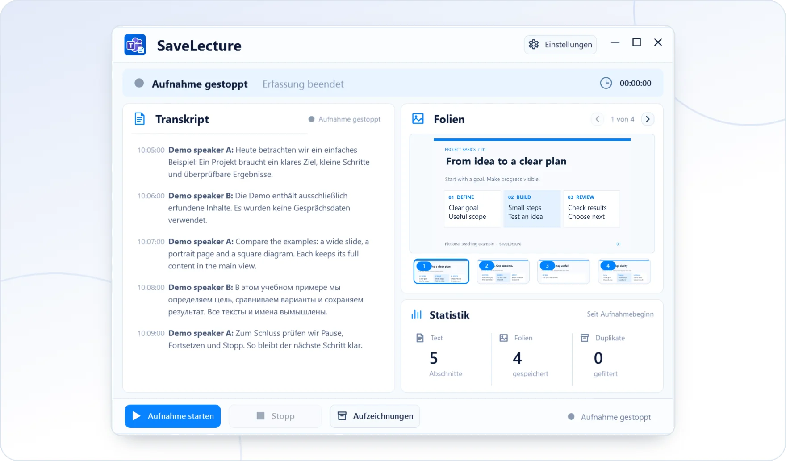

<!-- ppk-readme:body:start -->

<a href="https://github.com/popovantondev/SaveLecture/releases/tag/v0.1.0-preview.4"><picture><source media="(prefers-color-scheme: dark)" srcset="https://raw.githubusercontent.com/popovantondev/SaveLecture/main/docs/readme/btn-download-de-dark.28e521cb.svg"></picture></a>
<a href="https://popovantondev.github.io/SaveLecture/index.html"><picture><source media="(prefers-color-scheme: dark)" srcset="https://raw.githubusercontent.com/popovantondev/SaveLecture/main/docs/readme/btn-website-de-dark.d617c1cf.svg"></picture></a>
<a href="https://popovantondev.github.io/SaveLecture/Guide-de.html"><picture><source media="(prefers-color-scheme: dark)" srcset="https://raw.githubusercontent.com/popovantondev/SaveLecture/main/docs/readme/btn-guide-de-dark.0ebb585d.svg"></picture></a>
<a href="https://github.com/popovantondev/SaveLecture/issues/new"><picture><source media="(prefers-color-scheme: dark)" srcset="https://raw.githubusercontent.com/popovantondev/SaveLecture/main/docs/readme/btn-bug-de-dark.4f364764.svg"></picture></a>

<a href="https://raw.githubusercontent.com/popovantondev/SaveLecture/main/website/assets/demo-de.png"><picture><source media="(prefers-color-scheme: dark)" srcset="https://raw.githubusercontent.com/popovantondev/SaveLecture/main/docs/readme/preview-de-dark.33c04494.webp"></picture></a> 
<a href="https://raw.githubusercontent.com/popovantondev/SaveLecture/main/website/assets/demo-de.png">Ganzer Screenshot</a>

<picture><source media="(prefers-color-scheme: dark)" srcset="https://raw.githubusercontent.com/popovantondev/SaveLecture/main/docs/readme/divider-dark.ac532a77.svg"></picture>
<!-- ppk-readme:body:end -->
