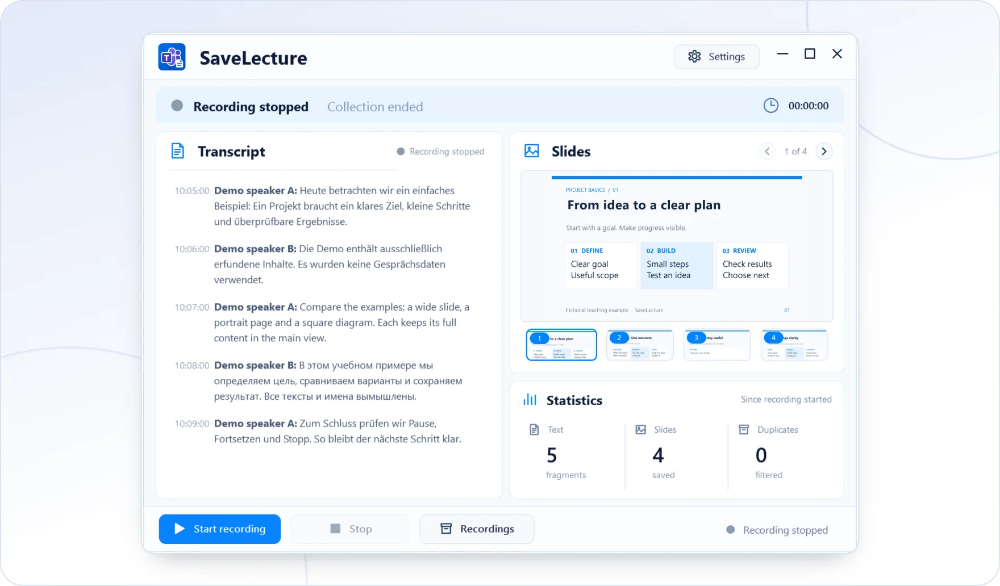

<!-- ppk-readme:body:start -->

<a href="https://github.com/popovantondev/SaveLecture/releases/tag/v0.1.0-preview.4"><picture><source media="(prefers-color-scheme: dark)" srcset="https://raw.githubusercontent.com/popovantondev/SaveLecture/main/docs/readme/btn-download-en-dark.b6378685.svg"></picture></a>
<a href="https://popovantondev.github.io/SaveLecture/index-en.html"><picture><source media="(prefers-color-scheme: dark)" srcset="https://raw.githubusercontent.com/popovantondev/SaveLecture/main/docs/readme/btn-website-en-dark.f74310a4.svg"></picture></a>
<a href="https://popovantondev.github.io/SaveLecture/Guide-en.html"><picture><source media="(prefers-color-scheme: dark)" srcset="https://raw.githubusercontent.com/popovantondev/SaveLecture/main/docs/readme/btn-guide-en-dark.92339d90.svg"></picture></a>
<a href="https://github.com/popovantondev/SaveLecture/issues/new"><picture><source media="(prefers-color-scheme: dark)" srcset="https://raw.githubusercontent.com/popovantondev/SaveLecture/main/docs/readme/btn-bug-en-dark.8da95498.svg"></picture></a>

<a href="https://raw.githubusercontent.com/popovantondev/SaveLecture/main/website/assets/demo-en.png"><picture><source media="(prefers-color-scheme: dark)" srcset="https://raw.githubusercontent.com/popovantondev/SaveLecture/main/docs/readme/preview-en-dark.571ecb22.webp"></picture></a> 
<a href="https://raw.githubusercontent.com/popovantondev/SaveLecture/main/website/assets/demo-en.png">Full screenshot</a>

<picture><source media="(prefers-color-scheme: dark)" srcset="https://raw.githubusercontent.com/popovantondev/SaveLecture/main/docs/readme/divider-dark.ac532a77.svg"></picture>
<!-- ppk-readme:body:end -->
