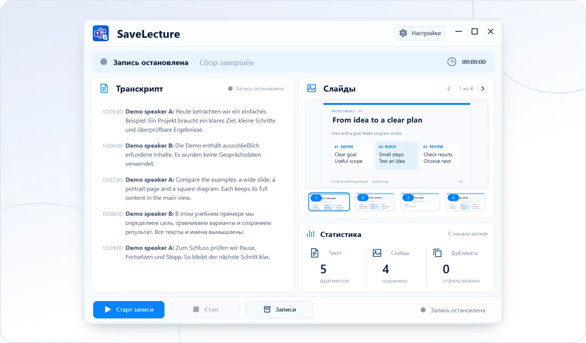

<!-- ppk-readme:body:start -->

<a href="https://github.com/popovantondev/SaveLecture/releases/tag/v0.1.0-preview.4"><picture><source media="(prefers-color-scheme: dark)" srcset="https://raw.githubusercontent.com/popovantondev/SaveLecture/main/docs/readme/btn-download-ru-dark.ab7b2e41.svg"></picture></a>
<a href="https://popovantondev.github.io/SaveLecture/index-ru.html"><picture><source media="(prefers-color-scheme: dark)" srcset="https://raw.githubusercontent.com/popovantondev/SaveLecture/main/docs/readme/btn-website-ru-dark.25964b9f.svg"></picture></a>
<a href="https://popovantondev.github.io/SaveLecture/Guide-ru.html"><picture><source media="(prefers-color-scheme: dark)" srcset="https://raw.githubusercontent.com/popovantondev/SaveLecture/main/docs/readme/btn-guide-ru-dark.b0865e9f.svg"></picture></a>
<a href="https://github.com/popovantondev/SaveLecture/issues/new"><picture><source media="(prefers-color-scheme: dark)" srcset="https://raw.githubusercontent.com/popovantondev/SaveLecture/main/docs/readme/btn-bug-ru-dark.79671373.svg"></picture></a>

<a href="https://raw.githubusercontent.com/popovantondev/SaveLecture/main/website/assets/demo-ru.png"><picture><source media="(prefers-color-scheme: dark)" srcset="https://raw.githubusercontent.com/popovantondev/SaveLecture/main/docs/readme/preview-ru-dark.1edab199.webp"></picture></a> 
<a href="https://raw.githubusercontent.com/popovantondev/SaveLecture/main/website/assets/demo-ru.png">Снимок целиком</a>

<picture><source media="(prefers-color-scheme: dark)" srcset="https://raw.githubusercontent.com/popovantondev/SaveLecture/main/docs/readme/divider-dark.ac532a77.svg"></picture>
<!-- ppk-readme:body:end -->
