<!-- ppk-readme:head:start -->
<a href="https://popovantondev.github.io/SaveLecture/index.html"><picture><source media="(prefers-color-scheme: dark)" srcset="https://raw.githubusercontent.com/popovantondev/SaveLecture/main/docs/readme/header-de-dark.9e2f5bb7.svg"></picture></a>
<!-- ppk-readme:head:end -->
